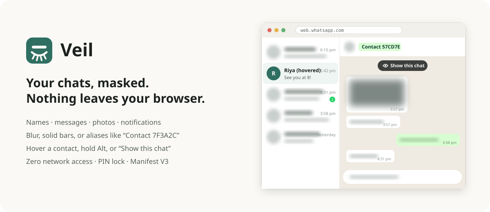
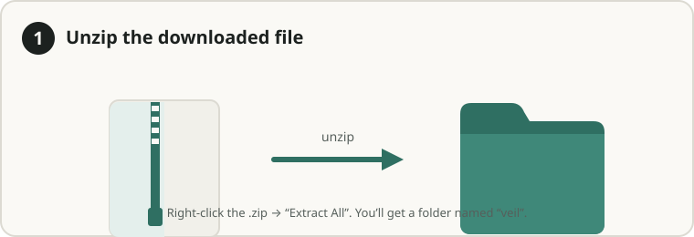
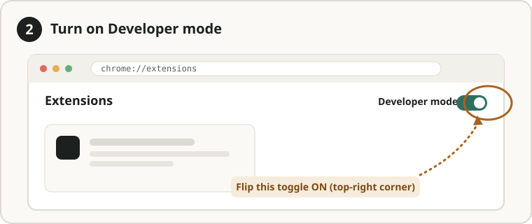
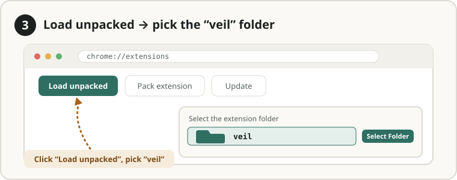

<h1 align="center">Veil: Privacy Mask for WhatsApp Web</h1>

<p align="center">
  Mask <b>contact names, messages, photos and notifications</b> on WhatsApp Web, so nobody can read your chats over your shoulder or on a screen-share. <b>Zero network access</b>: nothing ever leaves your browser.
</p>

<p align="center">
  <a href="https://github.com/pushpankar-kiran/veil-whatsapp-privacy/releases/latest"></a>
  <a href="LICENSE"></a>
  
  
  <a href="../../actions/workflows/build.yml"></a>
</p>

<p align="center">
  
</p>

Most WhatsApp privacy extensions blur by targeting WhatsApp's generated class names, so they silently stop working after every WhatsApp update. Veil finds content by page **structure** (ARIA roles, ids, data attributes), **fails closed** (WhatsApp stays blurred if anything goes wrong), and shows a **coverage meter** so you know it's working. See the [competitive gap analysis](docs/COMPETITIVE_GAP_ANALYSIS.md).

> **New here?** Jump to [Install in 3 steps](#option-a--load-the-packaged-extension-no-tools-needed). No tools required.

## Features

- 🙈 **Masks everything sensitive**: names, chat previews, messages, quoted replies, photos and media, profile photos, and the typing box, each with its own toggle
- 🎨 **Three mask styles**: Blur (adjustable), Redact (solid bars, safe on projectors and recordings), or **Aliases** (names become stable pseudonyms like "Contact 7F3A2C")
- 👆 **Hover a contact** to reveal that whole contact, or a message row, at once. Or **hold Alt** to peek, or turn reveal **off** for screen-sharing
- 👁️ **Show this chat**: reveal only the open conversation (on-page button, `Alt+Shift+U`, or the popup). It re-masks itself when you switch chats
- 🔔 **Leak guards**: desktop notifications just say "New message", and the unread count disappears from the tab title
- 🔒 **Privacy curtain**: panic lock (`Alt+Shift+L`), auto-lock on idle or tab switch, optional PIN with brute-force protection
- 🎤 **Presenter preset** (`Alt+Shift+P`): bars, aliases and no reveal in one keystroke
- 📊 **Coverage meter** and **Strict mode**: see how many items are masked, and mask every text and image if WhatsApp changes its layout
- 🛡️ **Zero network access**: `storage` permission only, no host permissions, connections blocked by CSP

## Install

### Option A: Load the packaged extension (no tools needed)

Nothing to install: download, unzip, and load. Works in Chrome, Edge, Brave, or any Chromium browser.

**Step 1: Download and unzip.** Grab the latest `veil-extension.zip` from the [Releases](../../releases) page and unzip it. You'll get a folder named `veil`.



**Step 2: Open `chrome://extensions` and turn on Developer mode** (toggle, top-right).



**Step 3: Click "Load unpacked" and select the `veil` folder.**



Then **reload your WhatsApp Web tab**. The green Veil icon appears in your toolbar; pin it from the puzzle-piece menu for quick access. Keep the `veil` folder where it is, because Chrome loads the extension from it.

### Option B: From source

There is no build step.

```bash
git clone https://github.com/pushpankar-kiran/veil-whatsapp-privacy.git
```

Then use **Load unpacked** as in Option A, and select the `extension/` folder.

## Usage

- **Open WhatsApp Web.** Everything sensitive is masked straight away.
- **Hover a contact or message** to reveal it, or click **Show this chat** to reveal the open conversation.
- **Click the toolbar icon** for presets, mask style, what to mask (with live counts), reveal mode, leak guards, and the lock screen and PIN.

| Shortcut | What it does |
|---|---|
| `Alt+Shift+X` | Masking on/off (with a PIN set, it can only turn masking on) |
| `Alt+Shift+L` | Lock WhatsApp now |
| `Alt+Shift+U` | Show / hide the open chat only |
| `Alt+Shift+P` | Presenter preset |
| Hold `Alt` | Peek, when Reveal is set to "Hold Alt" |

Rebind them at `chrome://extensions/shortcuts`.

## How it works

Fully client-side, with no dependencies and no build. A manifest stylesheet blurs the page at `document_start`, so nothing flashes while WhatsApp loads. A content script then installs the mask.

| Piece | What it does |
|---|---|
| `boot.css` | Fail-closed shield until the mask is ready |
| `content.js` | MutationObserver tagger that classifies names, previews, messages and media by structure before they paint; generates the mask CSS; reveal modes, lock screen, "Show this chat", self-repair |
| `notify-guard.js` | Runs in the page's world and rewrites `Notification` / `showNotification` to a generic text |
| `settings.js` | Settings schema and validation; PBKDF2 PIN hashing with back-off |
| `background.js` | Keyboard shortcuts, via `chrome.storage` only |

## Honest limitations

These are worth knowing before you rely on it:

- **Not yet tested across many real WhatsApp accounts.** Selectors were built from public sources and a mock page. If the coverage meter shows 0 for a category, turn on **Strict mode** and [file a bug](../../issues/new?template=bug_report.yml) with the structure-only report from `tools/dom-probe.js`.
- **Notifications sent by WhatsApp's service worker** (e.g. push while the tab is closed) can't be reached by an extension. Turn off message previews in your OS notification settings to cover those.
- **It protects against onlookers, not someone with your unlocked computer.** Anyone with time can disable an extension at `chrome://extensions`. Lock your PC when you step away.
- **Hover reveal is visible to anyone watching.** Use Presenter mode when screen-sharing.
- **WhatsApp can see that Veil is installed** (from its `data-veil` attributes). Nothing is sent anywhere.

## Privacy

No analytics, no telemetry, no network requests, no servers. Names are read only in memory, inside the tab, to compute aliases. Settings live in `chrome.storage.local` and are never synced. See [PRIVACY.md](extension/PRIVACY.md) and [SECURITY.md](SECURITY.md), which includes a full security review.

## Development

```bash
python tools/audit.py        # zero-network audit: fails on any network API or external URL
python tools/run_checks.py   # 51 headless behaviour + security checks (needs: pip install playwright)
python tools/package.py      # builds dist/veil-extension.zip
```

CI runs all three on every push. See [CONTRIBUTING.md](CONTRIBUTING.md) for the full setup, project layout and PR guidelines.

## Contributing

Contributions are welcome: bug reports, feature ideas, docs, and code. Start with [CONTRIBUTING.md](CONTRIBUTING.md), and please follow the [Code of Conduct](CODE_OF_CONDUCT.md). Found a security issue? See [SECURITY.md](SECURITY.md).

## Support the project

If this kept your chats private, please **⭐ star the repo**. It helps other people find it. Bug reports and PRs are just as appreciated.

## License

[MIT](LICENSE) © Pushpankar Kiran

<sub>WhatsApp is a trademark of WhatsApp LLC. Veil is an independent project and is not affiliated with or endorsed by WhatsApp or Meta.</sub>
